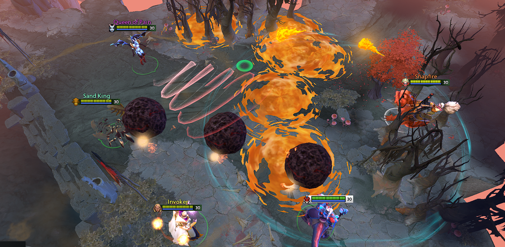

# Minimize Hero Spells

A mod for [Dota 2 Minify](https://github.com/Egezenn/dota2-minify) by **Ёу**.
Reduces visual clutter from hero spells by simplifying particle effects and disabling selected extra effects.

## Requirements

- Tested with **Minify 2rc4** and **2rc7**.
- Enable the built-in **Minify Spells & Items** mod alongside this mod.

## Install

Download `Minimize-Hero-Spells.zip` from [Releases](https://github.com/prostosaneyk/Minimize-Hero-Spells/releases).
Create `Minify/mods/Minimize Hero Spells/` and extract the ZIP contents there, with `manifest.json` directly inside that folder.
Enable **Minify Spells & Items** and **Minimize Hero Spells**, then apply your Minify patch.

## Contents

- `src/manifest.json`: mod metadata and dependency.
- `src/blacklist.txt`: particle effects to disable, with comments describing the changes.
- `src/files/`: 134 compiled particle replacements and one model.
- `src/notes.md`: description for the Minify UI.
- `src/preview.png`: in-game screenshot used by the community registry.

## Release

Push a version tag such as `1.0.0`. GitHub Actions packages the contents of `src/` into
`Minimize-Hero-Spells.zip` and attaches it to the corresponding GitHub Release.
The ZIP has `manifest.json` at its root, as required by the community installer.

## Community registry

Submit this mod through the [community submission form](https://github.com/Dota-Modding-Community/community/issues/new?template=submission.yml).
